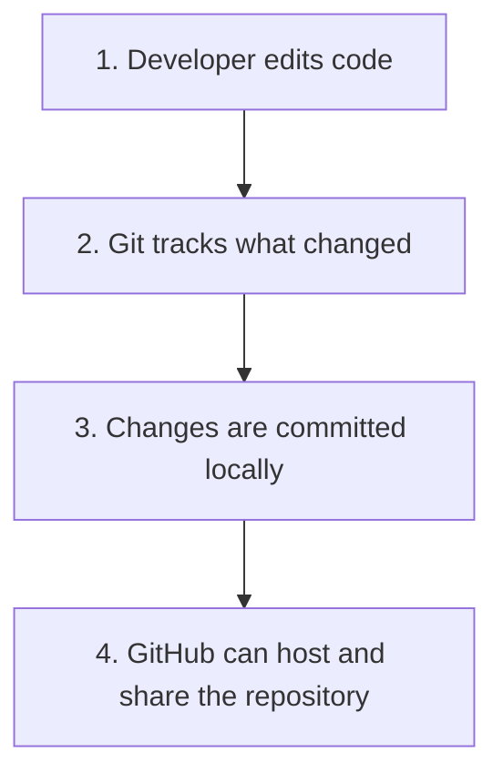
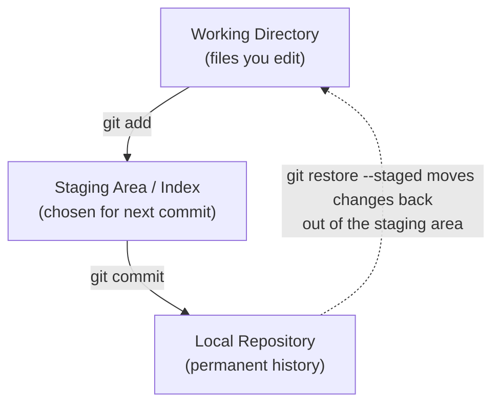
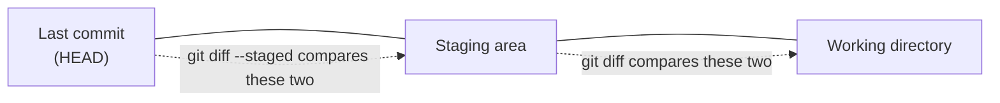
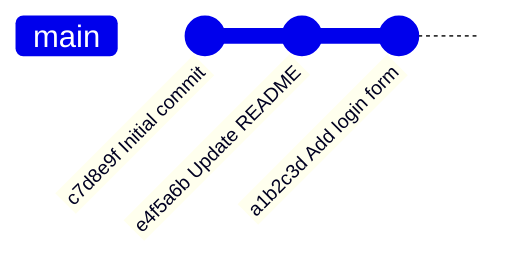
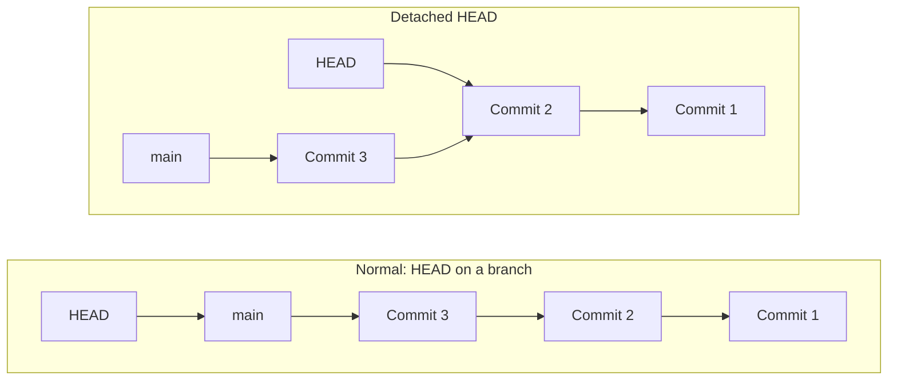
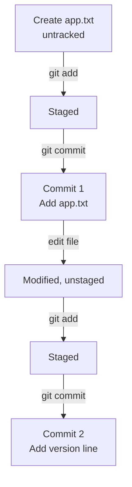

# Part 1: Git Fundamentals and Local Repository Operations

```text
┌──────────────────────────────────────────────┐
│ PART 1/3  git-workshop  [40 min]             │
│ $ git init && git commit                     │
└──────────────────────────────────────────────┘
user@laptop:~/workshop/01-fundamentals$ ./start_session.sh
```

**Teaching time: 40 minutes** | Part 1 of 3 | Next: [Part 2 - GitHub and Remotes](02-github-and-remote-operations.md)

---

## How to use this handbook

Every section is tagged so you can see at a glance what to do with it:

| Tag | Meaning |
|---|---|
| `[MUST_TEACH]` | Essential. Cover it in the workshop. |
| `[LIVE_DEMO]` | Type these commands in front of the students. |
| `[STUDENT_PRACTICE]` | Students type these commands themselves. |
| `[OPTIONAL]` | Only if you are ahead of schedule. |

Callouts used throughout: **Important**, **Remember**, **Common Mistake**, **Try It Yourself**.

> `[i] NOTE` on terminal output:** The sample outputs below were produced by running these exact commands with Git 2.43. Your students' hashes, dates and wording will differ slightly depending on their Git version. Say this out loud once so nobody panics when `a1b2c3d` does not match their screen.

---

## 1. Learning objectives

By the end of this part, students can:

- Explain what Git is and how it differs from GitHub.
- Explain repository, commit, and branch in one sentence each.
- Create (`git init`) or copy (`git clone`) a repository.
- Check changes, stage files, and commit them.
- Inspect differences and commit history.
- Undo basic local changes safely.
- Switch branches and look at an older commit without damaging anything.

---

## 2. What are Git and GitHub? `[MUST_TEACH]` (about 5 min)

### The analogy: checkpoints in a game

When you play a long video game, you save checkpoints. If you make a mistake, you reload an earlier checkpoint. Git does this for your project files.

Imagine a college project folder:

```text
project-final.zip
project-final-v2.zip
project-final-v2-REAL.zip
project-final-v2-REAL-submit-this.zip
```

Git replaces this mess with **one folder** and a **history of checkpoints** (called *commits*), each with a message saying what changed.

### Key definitions

| Term | Simple meaning |
|---|---|
| **Version control system** | A tool that records changes to files over time. |
| **Git** | A version control system that runs on your own computer. |
| **Repository (repo)** | Your project files plus their full history, stored in a hidden `.git` folder. |
| **Commit** | A saved snapshot of your tracked project content, with an author, date and message. |
| **Branch** | A named, movable pointer to a commit. (More in Part 3.) |
| **GitHub** | A website that hosts Git repositories online so people can share and collaborate. |

### Git vs GitHub

| | Git | GitHub |
|---|---|---|
| What is it? | A tool (software) | A website / online service |
| Where does it run? | On your laptop | On the internet |
| Needs internet? | **No** | **Yes** |
| Main job | Track history of your files | Host repositories, enable teamwork, pull requests |
| Can you use one without the other? | Yes, Git works alone | No. GitHub hosts *Git* repositories |

> `[i] REMEMBER` Git is the engine. GitHub is one of several places (GitLab and Bitbucket are others) where you can park the car and share it with a team.

### Big picture



Steps 1 to 3 happen on your laptop, offline. Step 4 is optional and needs internet. We reach step 4 in Part 2.

---

## 3. The three areas of Git `[MUST_TEACH]` (about 7 min)

This is the most important idea in Part 1. If students get this, every other command makes sense.

| Area | What it is | Real-life comparison |
|---|---|---|
| **Working directory** | The actual files you see and edit in your folder | Your desk, where you are working |
| **Staging area** (also called the **index**) | A waiting area listing what will go into the next commit | A box where you place the items you want photographed |
| **Local repository** | The permanent history of commits in `.git` | The photo album |



> The dotted arrow is a simplification. `git restore --staged` removes a file from the staging area but keeps your edits in the working file. More on this in section 4F.

### Why does the staging area exist?

Suppose you fixed a bug **and** started a new feature in the same afternoon. With staging you can commit the bug fix alone, then the feature separately. Each commit then has one clear purpose, which makes history readable and mistakes easier to undo.

### Example: edit, stage, commit `app.txt`

Assume `app.txt` was already committed earlier with the content `Hello Git`.

| Step | Command | Working directory | Staging area | Local repository |
|---|---|---|---|---|
| 0 | (start) | `Hello Git` | `Hello Git` | `Hello Git` |
| 1 | Edit file, add line `Version 2` | `Hello Git` + `Version 2` | `Hello Git` | `Hello Git` |
| 2 | `git add app.txt` | `Hello Git` + `Version 2` | `Hello Git` + `Version 2` | `Hello Git` |
| 3 | `git commit -m "Add version line"` | `Hello Git` + `Version 2` | `Hello Git` + `Version 2` | `Hello Git` + `Version 2` |

After step 3 all three areas agree, so `git status` says **working tree clean**.

---

## 4. Commands to teach

### A. Creating and copying repositories `[MUST_TEACH]`

### $ `git init`

**Purpose:** Turns the current folder into a new, empty Git repository by creating a hidden `.git` folder.

**When to use it:** You are starting a brand-new project on your laptop.

**Syntax:**
```bash
git init
```

**Example:**
```bash
mkdir my-project
cd my-project
git init
```

**Expected result:**
```text
Initialized empty Git repository in /home/student/my-project/.git/
```

**What it does NOT do:** It does not create any commits and does not connect to GitHub.

**Common mistake:** Running `git init` inside a folder that is already inside another repository, creating a repository inside a repository. Run `git status` first. If it says `not a git repository`, you are safe to `init`.

### $ `git clone <repository-url>`

**Purpose:** Copies an existing repository (usually from GitHub) to your laptop, including its full history.

**When to use it:** The project already exists online and you want a local copy.

**Syntax:**
```bash
git clone <repository-url>
```

**Example:**
```bash
git clone https://github.com/your-username/demo-repo.git
```

**Expected result:** A new folder `demo-repo/` containing the working files, a `.git` folder with the full history, and a remote called `origin` pointing at the source URL.

**What it does NOT do:** It does not copy GitHub issues or settings. It copies the Git repository only.

**Common mistake:** Cloning, then forgetting to `cd` into the new folder before running other Git commands.

### `init` vs `clone`

| | `git init` | `git clone <url>` |
|---|---|---|
| Starting point | Empty folder | Existing repository |
| History | None yet | Full copy of existing history |
| Remote configured? | No | Yes, `origin` automatically |
| Typical use | New project | Joining or copying a project |

---

### B. Checking repository status `[MUST_TEACH]`

### $ `git status`

**Purpose:** Shows what state your files are in: untracked, modified, staged, or clean.

**When to use it:** Constantly. Before and after almost every other command. If students remember one habit, it should be this.

**Syntax:**
```bash
git status
```

**Four states to recognise** (all outputs below are real):

**1. Untracked file**: Git sees the file but has never been told to track it.
```text
On branch main

No commits yet

Untracked files:
  (use "git add <file>..." to include in what will be committed)
	app.txt

nothing added to commit but untracked files present (use "git add" to track)
```

**2. Staged (ready to commit):**
```text
On branch main

No commits yet

Changes to be committed:
  (use "git rm --cached <file>..." to unstage)
	new file:   app.txt
```

**3. Modified but not staged** (shown here after the first commit exists):
```text
On branch main
Changes not staged for commit:
  (use "git add <file>..." to update what will be committed)
  (use "git restore <file>..." to discard changes in working directory)
	modified:   app.txt

no changes added to commit (use "git add" and/or "git commit -a")
```

**4. Clean working tree:**
```text
On branch main
nothing to commit, working tree clean
```

**Bonus (brief): Unmerged files during a conflict.** You will see this in Part 3:
```text
Unmerged paths:
  (use "git add <file>..." to mark resolution)
	both modified:   app.txt
```

> `[i] REMEMBER` `git status` even tells you the next command to try. Teach students to read the hints in parentheses.

| What `status` says | Meaning | Next step |
|---|---|---|
| Untracked files | New file Git is not tracking | `git add <file>` |
| Changes not staged for commit | Tracked file edited, not staged | `git add <file>` or `git restore <file>` |
| Changes to be committed | Staged, waiting for commit | `git commit -m "..."` |
| Working tree clean | Nothing to do | Carry on |

**What it does NOT do:** It does not change anything. It is completely safe to run.

---

### C. Staging and committing `[MUST_TEACH]`

### $ `git add`

**Purpose:** Copies the current version of a file into the staging area.

**When to use it:** When you have finished a piece of work and want it included in the next commit.

**Syntax:**
```bash
git add <file>        # one file
git add file1 file2   # several files
git add .             # everything under the current directory
```

**Example:**
```bash
git add app.txt
```

**Expected result:** `git status` now lists `app.txt` under "Changes to be committed".

**What it does NOT do:** It does not save to history. It only stages. Nothing is permanent yet.

**How `git add .` works:** The dot means "the current directory and everything inside it". If you run it from a subfolder, it stages changes in that subfolder (and below), not necessarily the whole project. Always check `git status` first.

**Common mistake: staging sensitive files.**

> `[!] IMPORTANT` Never stage `.env` files, passwords, API keys, or private tokens. Once committed and pushed, secrets are very hard to fully remove. Review `git status` *before* `git add .`. Later, a `.gitignore` file can tell Git to ignore such files.

### $ `git commit -m "message"`

**Purpose:** Records everything in the staging area as a new snapshot in the local repository.

**When to use it:** After staging a logical, finished unit of work.

**Syntax:**
```bash
git commit -m "message"
```

**Example:**
```bash
git commit -m "Add app.txt"
```

**Expected result (real output):**
```text
[main (root-commit) 758cd23] Add app.txt
 1 file changed, 1 insertion(+)
 create mode 100644 app.txt
```

`758cd23` is the abbreviated commit hash, which is the unique ID of this commit.

**What it does NOT do:** It does not upload anything. **Commits are local until you push them** (Part 2). It also does not commit unstaged edits.

**Common mistakes:**
- Forgetting `-m`. Git opens a text editor (often vim) and students get stuck. To exit vim: press `Esc`, type `:q!`, press Enter, then retry with `-m`.
- Useless messages such as `update`, `fix`, `asdf`.

| Weak message | Better message |
|---|---|
| `update` | `Add login form validation` |
| `changes` | `Fix crash when username is empty` |
| `final` | `Update README with setup steps` |

A good message completes the sentence: "This commit will ... ".

---

### D. Comparing changes `[MUST_TEACH]`

### Commands: `git diff` and `git diff --staged`

**Purpose:** Show exactly *which lines* changed.

| Command | Compares | Shows |
|---|---|---|
| `git diff` | Working directory **vs** staging area | **Unstaged** changes |
| `git diff --staged` | Staging area **vs** `HEAD` (the current commit) | **Staged** changes, i.e. what the next commit will contain |



**Example (real output).** `app.txt` contained `Hello Git`; we appended `Version 2`:
```text
diff --git a/app.txt b/app.txt
index 9f4d96d..4a11958 100644
--- a/app.txt
+++ b/app.txt
@@ -1 +1,2 @@
 Hello Git
+Version 2
```

How to read it:

| Symbol | Meaning |
|---|---|
| `---` / `+++` | Old version (`a/`) and new version (`b/`) of the file |
| `@@ -1 +1,2 @@` | Location: old text started at line 1; new text has 2 lines |
| Line starting with space | Unchanged line (context) |
| Line starting with `-` | Line **removed** |
| Line starting with `+` | Line **added** |

A *changed* line appears as one `-` line followed by one `+` line:
```diff
-Hello Git
+Hello World
```

> `[x] COMMON_MISTAKE` "I ran `git diff` and it shows nothing, but I changed the file!" Most likely the file is **already staged**. `git diff` only shows *unstaged* changes. Try `git diff --staged`.

**Habit to teach:** Run `git diff --staged` right before every `git commit` to review exactly what you are about to save.

---

### E. Viewing commit history `[MUST_TEACH]`

### $ `git log --oneline`

**Purpose:** Shows the commit history, one line per commit, newest first.

**Syntax and example:**
```bash
git log --oneline
```

**Real output from the exercise:**
```text
d825824 Add version line
758cd23 Add app.txt
```

**Illustrative longer history** (your hashes and messages will differ):
```text
a1b2c3d Add login form
e4f5a6b Update README
c7d8e9f Initial commit
```

Each line = **abbreviated hash** + **commit message**. The top line is the newest commit.



**What it does NOT do:** It does not show uncommitted work. If the log is long, press `q` to quit the pager.

---

### F. Undoing local changes `[MUST_TEACH]` `[WARNING]`

### Command: `git restore --staged <file>` (unstage)

**Purpose:** Removes a file from the staging area.

**When to use it:** You staged a file by mistake.

**Syntax:**
```bash
git restore --staged app.txt
```

**Expected result:** The file moves from "Changes to be committed" back to "Changes not staged for commit". **Your edits are still in the file.**

**What it does NOT do:** It does not delete or revert your edits.

### Command: `git restore <file>` (discard edits) `[CAREFUL]`

**Purpose:** Replaces the working file with the version from the staging area (or, if nothing is staged, the last commit). **Your unstaged edits are thrown away.**

**When to use it:** You edited a file and want to throw those edits away.

**Syntax:**
```bash
git restore app.txt
```

> `[!] IMPORTANT` Discarded, uncommitted edits generally **cannot be recovered**. Run `git diff` first and be sure.

| | `git restore --staged app.txt` | `git restore app.txt` |
|---|---|---|
| Touches | Staging area | Working file |
| Your edits | **Kept** | **Lost** |
| Risk | Low | **High** |

### Before and after (real run)

| Situation | Before | Command | After |
|---|---|---|---|
| File edited and staged | `status`: Changes to be committed, `app.txt` | `git restore --staged app.txt` | `status`: ` M app.txt` (modified, unstaged); edit still present |
| File edited, not staged | `status`: modified `app.txt` | `git restore app.txt` | `status`: working tree clean; edit gone |

### Brief caution: `git restore .`

This applies `git restore` to **every tracked file under the current directory and its subfolders**, discarding all their unstaged edits at once.

> `[!] IMPORTANT` Treat this as a "know what you are doing" command. Do **not** run it casually, and do **not** demonstrate it on a repo with real work in it.

> `[x] COMMON_MISTAKE` Using `git restore` when you meant `git restore --staged`. One keeps your work; the other deletes it.

---

### G. Author configuration `[MUST_TEACH]` (do first in the exercise)

### $ `git config --global user.name` / `user.email`

**Purpose:** Sets the author identity written into every new commit.

**Syntax:**
```bash
git config --global user.name "Your Name"
git config --global user.email "you@example.com"
```

**Check it:**
```bash
git config --global --list
```

**Notes for students:**
- This is **not** logging into GitHub. It is just a label stamped on commits.
- Use an email you are comfortable having in commit history. GitHub offers a private "noreply" email address in your email settings if you prefer not to expose your real one.
- `--global` means "for every repository on this computer". Set it once.

**Common mistake:** Skipping it, then seeing `Please tell me who you are` when committing.

---

### H. Switching branches and inspecting commits `[MUST_TEACH]`

### Commands: `git switch` and `git switch --detach`

| Command | What it does |
|---|---|
| `git switch <branch>` | Moves to an existing branch |
| `git switch --detach <commit-hash>` | Checks out an old commit directly. `HEAD` becomes **detached** |
| `git checkout <branch-or-commit>` | Older, multi-purpose command doing both jobs (and more). You will see it in tutorials, so recognise it. Prefer `switch` |

### What is `HEAD`?

`HEAD` means "where you are now". Normally `HEAD` points to a **branch name**, and the branch points to a commit. In a **detached HEAD**, `HEAD` points straight at a commit.



**Try it (real output):**
```bash
git switch --detach HEAD~1
```
```text
HEAD is now at 758cd23 Add app.txt
```
`HEAD~1` means "one commit before HEAD". You can also paste a real hash from `git log --oneline`.

`git status` now says `HEAD detached at 758cd23`. Your files look like they did at that old commit. **Newer commits are not deleted.** They are still there; `HEAD` is just not pointing at them.

**Return safely:**
```bash
git switch main
```

> `[i] REMEMBER` Detached HEAD is for *looking around*. If you make commits while detached, they belong to no branch and are easy to lose. For now: look, then `git switch main`.

---

### I. Recovery concepts `[OPTIONAL]` (talk only, do not demo)

| | `git revert <commit-hash>` | `git reset --hard <commit-hash>` |
|---|---|---|
| What it does | Creates a **new commit** that reverses an earlier commit | **Moves the current branch** to that commit and resets the index and tracked working files to match |
| History | Preserved (adds to it) | Rewritten (later commits no longer on the branch) |
| Uncommitted work | Safe | **Can be permanently discarded** |
| Risk | Low | **High** |
| Safe for shared history? | Yes | No |

> `[!] IMPORTANT` Do not use `git reset --hard` as a routine "fix". If students are unsure what a command does, they should ask first, run `git status`, and avoid destructive options.

---

## 5. Complete hands-on exercise `[LIVE_DEMO]` `[STUDENT_PRACTICE]` (about 12 min)

> `[!] IMPORTANT` Do this in a **brand-new empty folder**. Never run `git init` inside an existing project unless you understand its repository state.

You demonstrate each step; students follow along. Outputs are real (hashes will differ on their machines).

**Step 1 to 3: Create a folder, initialize, configure identity (skip config if already set)**
```bash
mkdir git-practice
cd git-practice
git init -b main
git config --global user.name "Your Name"
git config --global user.email "you@example.com"
```
```text
Initialized empty Git repository in /home/student/git-practice/.git/
```
> `-b main` names the first branch `main` (needs Git 2.28+). On older versions, run `git init` and then `git branch -M main`.

**Step 4: Create `app.txt`**
```bash
echo "Hello Git" > app.txt
```

**Step 5: Check status** (expect: *Untracked files*)
```bash
git status
```

**Step 6: Stage it**
```bash
git add app.txt
```

**Step 7: Inspect the staged change**
```bash
git diff --staged
```
```text
diff --git a/app.txt b/app.txt
new file mode 100644
index 0000000..9f4d96d
--- /dev/null
+++ b/app.txt
@@ -0,0 +1 @@
+Hello Git
```

**Step 8: Commit**
```bash
git commit -m "Add app.txt"
```
```text
[main (root-commit) 758cd23] Add app.txt
 1 file changed, 1 insertion(+)
 create mode 100644 app.txt
```

**Step 9: Edit the file** (append a line)
```bash
echo "Version 2" >> app.txt
```
> `>>` appends; a single `>` would overwrite the file.

**Step 10: Inspect unstaged changes**
```bash
git diff
```
```text
diff --git a/app.txt b/app.txt
index 9f4d96d..4a11958 100644
--- a/app.txt
+++ b/app.txt
@@ -1 +1,2 @@
 Hello Git
+Version 2
```

**Step 11: Stage and inspect the new change**
```bash
git add app.txt
git diff --staged
```
(The same diff now appears under `--staged`, and plain `git diff` is empty.)

**Step 12: Commit again**
```bash
git commit -m "Add version line"
```
```text
[main d825824] Add version line
 1 file changed, 1 insertion(+)
```

**Step 13: Review history**
```bash
git log --oneline
```
```text
d825824 Add version line
758cd23 Add app.txt
```

**Check:** `git status` should say `nothing to commit, working tree clean`.



`[>] TRY_IT` (3 min, STUDENT PRACTICE):** Append a line `Oops`, run `git add app.txt`, then undo with `git restore --staged app.txt`. Check `git status` and `cat app.txt`. Is `Oops` still in the file? (Yes.) Then run `git restore app.txt` and check again. (It is gone.)

---

## 6. Visual exercise `[STUDENT_PRACTICE]` (about 3 min)

**Setup:** `app.txt` is committed and contains `Hello Git`.

Students predict what `git status` and the three areas look like after each step:

1. Edit `app.txt`: add `Line A`.
2. Run `git add app.txt`.
3. Edit `app.txt` again: add `Line B`.
4. Run `git diff`.
5. Run `git diff --staged`.
6. Run `git commit -m "..."`.

Ask: *Which line ends up in the commit? Which line is left behind?*

<details>
<summary><strong>Answer (click to reveal; hide this while teaching)</strong></summary>

| Step | Working file | Staging area | Last commit | What the command shows |
|---|---|---|---|---|
| 1. Edit (Line A) | Hello Git, Line A | Hello Git | Hello Git | (nothing yet) |
| 2. `git add` | Hello Git, Line A | Hello Git, **Line A** | Hello Git | (nothing) |
| 3. Edit (Line B) | Hello Git, Line A, **Line B** | Hello Git, Line A | Hello Git | (nothing) |
| 4. `git diff` | same | same | same | `+Line B` only (working file vs staging) |
| 5. `git diff --staged` | same | same | same | `+Line A` only (staging vs last commit) |
| 6. `git commit` | Hello Git, Line A, Line B | Hello Git, Line A | **Hello Git, Line A** | Commit contains **Line A only** |

After step 6, `git status` still shows `app.txt` as **modified** because **Line B** is not committed yet.

**Lesson:** `git add` stages the file's content *at that moment*. Later edits need another `git add`.

</details>

---

## 7. Teaching schedule (40 minutes)

| Time | Activity | Type | Section |
|---|---|---|---|
| 0:00 - 0:05 | What are Git and GitHub, analogy, big-picture diagram | `[MUST_TEACH]` | 2 |
| 0:05 - 0:12 | Three areas: working directory, staging, repository | `[MUST_TEACH]` | 3 |
| 0:12 - 0:15 | `init`, `clone`, `config` (quick) | `[MUST_TEACH]` | 4A, 4G |
| 0:15 - 0:27 | Live exercise: status, add, diff, commit, log | `[LIVE_DEMO]` + `[STUDENT_PRACTICE]` | 5 |
| 0:27 - 0:32 | Undo with `restore` (demo, then students try) | `[LIVE_DEMO]` + `[STUDENT_PRACTICE]` | 4F |
| 0:32 - 0:36 | Detached HEAD: look around and return | `[LIVE_DEMO]` | 4H |
| 0:36 - 0:38 | Visual exercise (predict, then reveal) | `[STUDENT_PRACTICE]` | 6 |
| 0:38 - 0:40 | Recap and transition to GitHub | `[MUST_TEACH]` | 8 |
| (spare) | `revert` / `reset --hard` explanation | `[OPTIONAL]` | 4I |

> **Timing tip:** If you run late, cut 4H to a two-minute demo and move the visual exercise to the start of Part 2.

---

## 8. End-of-part recap

### Command reference

| Command | Purpose |
|---|---|
| `git init` | Start a new repository here |
| `git clone <url>` | Copy an existing repository |
| `git config --global user.name "..."` / `user.email "..."` | Set commit author identity |
| `git status` | See the state of files |
| `git add <file>` / `git add .` | Stage changes |
| `git commit -m "msg"` | Save staged snapshot locally |
| `git diff` | Unstaged changes |
| `git diff --staged` | Staged changes |
| `git log --oneline` | Short history |
| `git restore --staged <file>` | Unstage (keeps edits) |
| `git restore <file>` | Discard unstaged edits (**destructive**) |
| `git switch <branch>` | Change branch |
| `git switch --detach <hash>` | Look at an old commit |

### Five common beginner mistakes

1. Running Git commands outside the repository folder (`fatal: not a git repository`).
2. Believing `git add` saves history. Only `git commit` does.
3. Committing without `-m` and getting stuck in an editor.
4. Using `git restore <file>` and losing work that could have been kept.
5. Staging everything with `git add .` without checking for secrets or junk files.

### Five comprehension questions

1. What is the difference between Git and GitHub?
2. Name the three areas a change moves through, in order.
3. You edited a file and staged it. Which command shows what will be committed?
4. What does `git restore --staged app.txt` do to your edits?
5. After `git switch --detach <hash>`, are newer commits deleted?

<details>
<summary><strong>Answers</strong></summary>

1. Git is the version-control tool that runs locally; GitHub is an online service that hosts Git repositories.
2. Working directory, then staging area, then local repository.
3. `git diff --staged`.
4. It removes the file from staging only; the edits remain in the working file.
5. No. They still exist; `HEAD` just points at an older commit. `git switch main` returns you.

</details>

### Transition to Part 2

So far, everything lives on **one laptop**. If that laptop breaks, or a teammate needs your code, we have a problem. Next, we connect our local repository to **GitHub**, so work can be backed up and shared, and we learn how local and remote repositories talk to each other with `push`, `fetch`, and `pull`.

**Continue to:** [Part 2: GitHub and Remote Operations](02-github-and-remote-operations.md)
