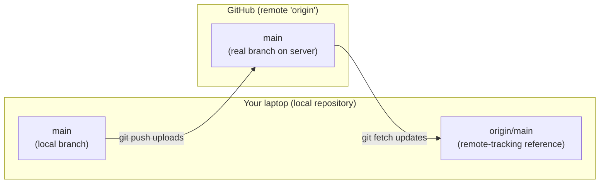
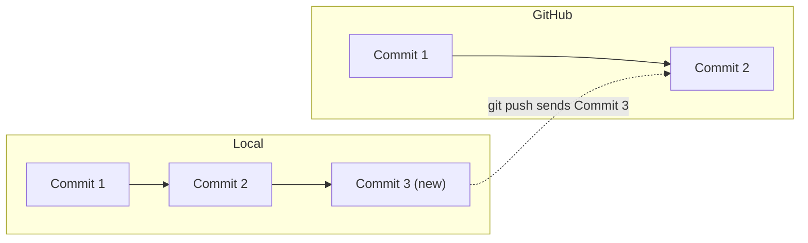
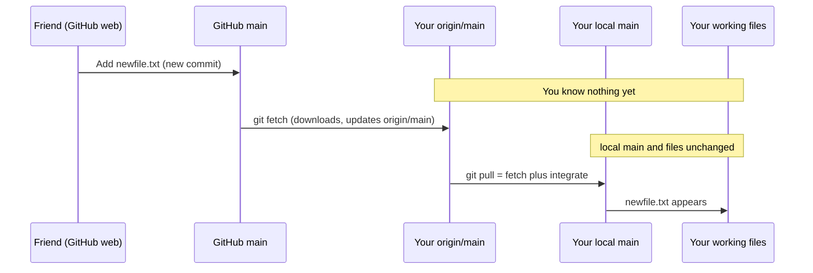
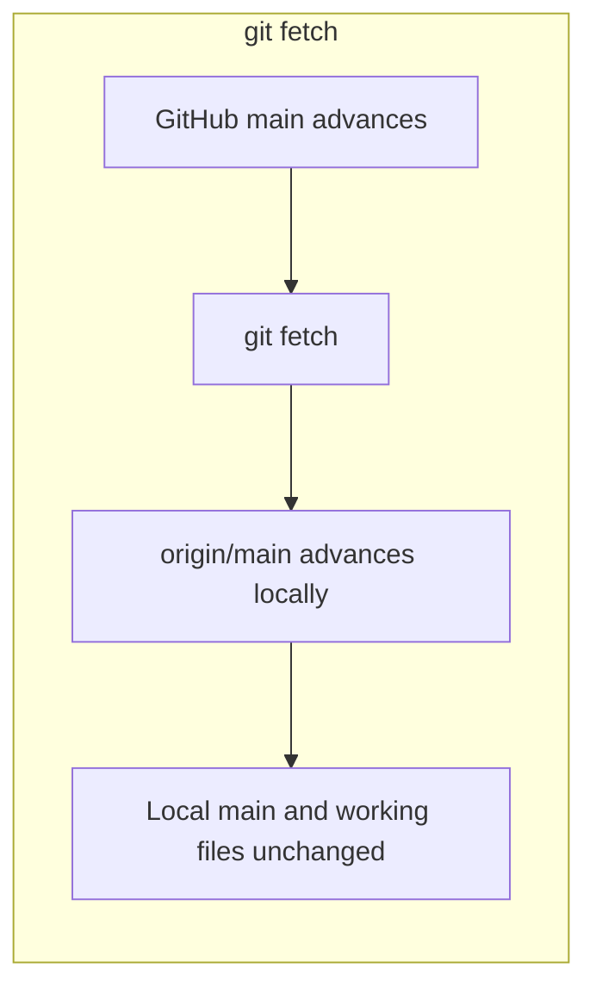
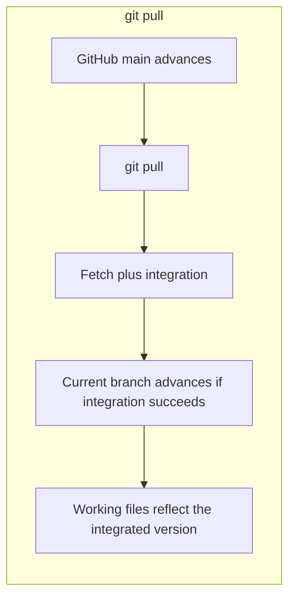
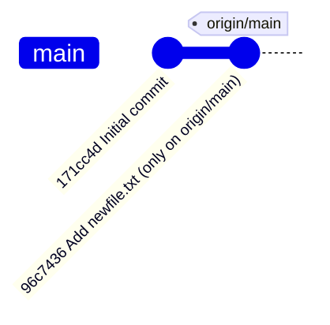

# Part 2: GitHub, Remotes, Push, Fetch, and Pull

```text
┌──────────────────────────────────────────────┐
│ PART 2/3  git-workshop  [40 min]             │
│ $ git push && git fetch && git pull          │
└──────────────────────────────────────────────┘
user@laptop:~/workshop/02-remotes$ ./start_session.sh
```

**Teaching time: 40 minutes** | Part 2 of 3 | Previous: [Part 1](01-git-fundamentals.md) | Next: [Part 3](03-branching-merging-and-collaboration.md)

Tags: `[MUST_TEACH]`, `[LIVE_DEMO]`, `[STUDENT_PRACTICE]`, `[OPTIONAL]`. Callouts: **Important**, **Remember**, **Common Mistake**, **Try It Yourself**.

> `[i] NOTE` on outputs:** Sample outputs were produced by running these commands against a local test remote with Git 2.43. Real GitHub output has the same shape, but URLs and extra lines (like "remote: Enumerating objects...") will differ. Hashes always differ.

**The heart of this part:** `git fetch` versus `git pull`. Give it the most time.

---

## 1. Learning objectives

Students can:

- Explain what a remote repository is.
- Connect a local repository to GitHub and push commits.
- Use `git fetch` to download remote changes **without** changing their files.
- Use `git pull` to download **and integrate** remote changes.
- Tell local branches from remote-tracking branches (`git branch`, `-r`, `-a`).
- Inspect incoming commits before integrating them.

---

## 2. Local vs remote repositories `[MUST_TEACH]` (about 6 min)

| Term | Meaning |
|---|---|
| **Local repository** | The repository on your laptop |
| **Remote repository** | A copy of the repository hosted somewhere else (here: GitHub) |
| **Remote name** | A short nickname for a remote URL |
| **`origin`** | The conventional nickname for the main remote (what `git clone` sets up). It could technically be named anything |
| **Local branch** | A branch you can commit to, e.g. `main` |
| **Remote-tracking branch** | A **local bookmark** such as `origin/main` that records where the remote branch was *the last time you checked* |
| **Upstream tracking** | A link saying "my local `main` normally pairs with `origin/main`" |

### The key picture



> `[!] IMPORTANT` `origin/main` is **not** a live branch on GitHub. It is a note stored **on your laptop** saying "last time I contacted GitHub, its `main` was at this commit." Only `git fetch`, `git pull` and `git push` refresh that note. Say this twice.

**Analogy:** You phone a friend and write down their score: "Friend: 40 points." That note is `origin/main`. Your friend may score more, but your note changes only when you phone again (`git fetch`).

---

## 3. Connecting to GitHub `[MUST_TEACH]` (about 4 min)

### $ `git remote -v`

**Purpose:** Lists the remotes configured in this repository, with their URLs.

**When to use it:** To check whether a remote exists before adding one, or to see where `push` goes.

**Syntax and sample output:**
```bash
git remote -v
```
```text
origin	https://github.com/your-username/demo-repo.git (fetch)
origin	https://github.com/your-username/demo-repo.git (push)
```
Two lines because fetch and push *can* use different URLs. Usually they are the same.

**What it does NOT do:** It does not contact GitHub. It only reads local configuration.

**Remote URLs** come in two common forms: HTTPS (`https://github.com/user/repo.git`) and SSH (`git@github.com:user/repo.git`). Which you use depends on how you authenticate. Today, either is fine.

> **Authentication note:** GitHub does not accept your account password for Git over HTTPS. Students need a personal access token, GitHub CLI login, a credential manager, or an SSH key. **Set this up before the workshop** or it will eat your time.

### $ `git remote add origin <repository-url>`

**Purpose:** Registers a new remote called `origin`.

**When to use it:** You ran `git init` locally, created an empty repository on GitHub, and want to link them. **Not needed after `git clone`**, which already did it.

**Syntax and example:**
```bash
git remote add origin https://github.com/your-username/demo-repo.git
```

**Expected result:** No output. Verify with `git remote -v`.

**Common mistake:** Running it twice, or after cloning:
```text
error: remote origin already exists.
```
Fix: check `git remote -v`. If the URL is wrong, use `git remote set-url origin <correct-url>`.

### $ `git remote show origin`

**Purpose:** Shows detailed information about the remote, including its branches and how your local branches are tracked.

**Syntax:**
```bash
git remote show origin
```
Unlike `git remote -v`, this **contacts** the remote. Mention it exists; don't dwell on it.

---

## 4. Uploading changes with push `[MUST_TEACH]` (about 5 min)

### $ `git push -u origin main`

**Purpose:** Uploads your local `main` commits to the remote `origin`, and sets up upstream tracking.

**When to use it:** The **first** time you push a branch.

**Syntax:**
```bash
git push -u origin main
```

| Part | Meaning |
|---|---|
| `git push` | Upload commits |
| `origin` | To the remote nicknamed `origin` |
| `main` | Push the local branch named `main` |
| `-u` | Also remember "local `main` tracks `origin/main`" (upstream tracking) |

**Real output (local test remote):**
```text
To /tmp/t/remote.git
 * [new branch]      main -> main
branch 'main' set up to track 'origin/main'.
```
On GitHub you will see extra lines such as "Enumerating objects" and "Writing objects".

**Prerequisites:** You must have at least one commit, and the branch name must match. Newer repositories use `main`; older ones use `master`. Check with `git branch`.

### $ `git push`

**Purpose:** Uploads new commits on the current branch to its upstream.

**When to use it:** Every time after the first push. Because `-u` set the upstream, no extra arguments are needed.

```bash
git push
```

### What actually gets uploaded?

Git uploads **commits** (and the data they need), not "changed files". The remote has to receive proper history so everyone's repository stays consistent.



### When push fails

| Situation | What you see | Meaning |
|---|---|---|
| **No permission** | `Permission denied` / `403` | You are not a collaborator or are logged in as the wrong account |
| **Remote has newer commits** | `! [rejected] main -> main (fetch first)` | Someone pushed first. Git refuses to overwrite their work |
| **No upstream set** | `fatal: The current branch X has no upstream branch` | Use `git push -u origin X` once |

**Real output of a rejected push:**
```text
 ! [rejected]        main -> main (fetch first)
error: failed to push some refs to '...'
hint: Updates were rejected because the remote contains work that you do not
hint: have locally. ...
```

**Fix:** `git pull` (integrate their commits), resolve any conflicts, then `git push` again.

> `[!] IMPORTANT` Do **not** "fix" a rejected push with `git push --force`. That can erase teammates' work. Pull first.

**What push does NOT do:** It does not upload uncommitted changes, and it does not touch your working files.

---

## 5. The big one: `git fetch` vs `git pull` `[MUST_TEACH]` (about 14 min)

### The scenario

1. You cloned a repository from GitHub. You are on local `main`.
2. Your friend opens GitHub **in the browser**, adds `newfile.txt`, and commits it to the remote `main`.
3. Your laptop does not know. Your folder does not contain `newfile.txt`.



### $ `git fetch`

**Purpose:** Contacts the remote, downloads new commits and updates your **remote-tracking branches** (like `origin/main`).

**When to use it:** When you want to *see* what changed remotely before deciding what to do with it. A safe "check for news".

**Syntax:**
```bash
git fetch
```

**Real output:**
```text
From /tmp/t/remote
   171cc4d..96c7436  main            -> origin/main
```
Read it as: "remote `main` moved from `171cc4d` to `96c7436`; I updated `origin/main` accordingly."

**Expected result:** `ls` still does **not** show `newfile.txt`. **This is expected.**

**Why:**

- `fetch` downloads remote objects and updates remote-tracking references.
- It does **not** merge or rebase anything into your current branch.
- It does **not** change your working files.
- Your local `main` has not moved.

`git status` now tells you the story:
```text
On branch main
Your branch is behind 'origin/main' by 1 commit, and can be fast-forwarded.
  (use "git pull" to update your local branch)
```

**What it does NOT do:** Modify your work. It is always safe to run.

### Inspect what arrived `[LIVE_DEMO]`

```bash
git branch -r
git branch -a
git log --oneline main..origin/main
```

Real output:

```text
$ git branch -r
  origin/feature-payment
  origin/main

$ git branch -a
* main
  remotes/origin/feature-payment
  remotes/origin/main

$ git log --oneline main..origin/main
96c7436 Add newfile.txt
```

(`git branch -r` prints `origin/main`; `git branch -a` prints the longer `remotes/origin/main`. Same thing, two display styles.)

### $ `git pull`

**Purpose:** `git fetch` **plus** integrating the fetched changes into your **current branch**.

**When to use it:** You are on the branch you want to update, you have looked at what is incoming (or trust it), and you want those changes in your files.

**Syntax:**
```bash
git pull
```

**Real output:**
```text
Updating 171cc4d..96c7436
Fast-forward
 newfile.txt | 1 +
 1 file changed, 1 insertion(+)
 create mode 100644 newfile.txt
```

**Expected result:** `newfile.txt` now exists in your folder and `git log --oneline` shows the new commit.

**Requirements:** You are on the intended branch, and its upstream is configured (it is automatically, after a clone or `push -u`).

**How does it integrate?** By default a *merge* (a fast-forward if possible, otherwise a merge commit). It can *rebase* instead if configured (`pull.rebase`). So never say "pull always merges". Say: "pull fetches, then integrates, usually by merging."

**If your local and remote changes conflict:** pull stops with a merge conflict in the affected files. You resolve it exactly as in Part 3. `git status` shows `Unmerged paths`.

### $ `git pull origin main`

**Purpose:** Fetch `main` from `origin` and integrate it into whatever branch you are **currently on**.

> `[!] IMPORTANT` This does **not** switch you to local `main`. If you are on `feature-x` and run `git pull origin main`, Git tries to integrate `origin/main` **into `feature-x`**. Always check `git branch` (the `*`) first.

### Side-by-side comparison





| | `git fetch` | `git pull` |
|---|---|---|
| Downloads remote commits? | Yes | Yes (it runs fetch first) |
| Updates `origin/main`? | Yes | Yes |
| Changes your current branch? | **No** | **Yes**, if integration succeeds |
| Changes your working files? | **No** | **Yes** |
| Can cause conflicts? | **No** | **Yes** |
| Safe to run any time? | Yes | Check `git status` first |
| Think of it as | "Check for news" | "Get the news and apply it" |

> `[i] REMEMBER` `git pull` = `git fetch` + integrate (merge or rebase).

---

## 6. Listing branches `[MUST_TEACH]` (about 3 min)

| Command | Lists |
|---|---|
| `git branch` | **Local** branches |
| `git branch -r` | **Remote-tracking** branches (as of last fetch) |
| `git branch -a` | **Both** |

Illustrative `git branch -a` output:
```text
  feature-login
* main
  remotes/origin/main
  remotes/origin/feature-payment
```

- `*` marks the branch you are on.
- `remotes/origin/main` is the full name of the remote-tracking branch, informally `origin/main`.

**Why doesn't my friend's new remote branch appear?** Your laptop only knows what it learned at the last fetch. Run `git fetch`, then list again.

**Common mistake:** Thinking `git branch -r` downloads that branch's files. It only **lists references**. Your working files stay the same. To work on a remote branch, create a local branch from it (for example `git switch feature-payment`, which creates a tracking branch when exactly one matching remote branch exists).

---

## 7. Inspecting incoming commits `[MUST_TEACH]`

```bash
git log --oneline main..origin/main
```

Read `A..B` as **"commits reachable from B that are not reachable from A"**. Here: commits on `origin/main` that your local `main` does not have yet.



**Output:** one line per incoming commit.
```text
96c7436 Add newfile.txt
```
- **Empty output:** nothing incoming; you are up to date (as of the last fetch).
- Assumes `main` and `origin/main` are the branches you mean. Adapt names otherwise.

Habit: **fetch, look, then pull.**

---

## 8. Complete practical demonstration `[LIVE_DEMO]` `[STUDENT_PRACTICE]` (about 8 min)

**Prerequisites (tell students beforehand):**

- Git installed; author identity configured (Part 1).
- A GitHub account and working authentication (token, CLI login, or SSH key).
- Branch name: this exercise uses `main`. If `git branch` shows `master`, substitute it throughout.
- Create an **empty** repository on GitHub called `demo-repo` (no README, no .gitignore) so the first push is simple.

Legend: `[TERMINAL]` = type in the terminal. `[BROWSER]` = do on github.com.

| # | Where | Action |
|---|---|---|
| 1 | TERMINAL | Create a local repo with a commit |
| 2 | TERMINAL | Connect to GitHub |
| 3 | TERMINAL | Push the initial branch |
| 4 | BROWSER | Add `newfile.txt` on GitHub |
| 5 | TERMINAL | `git fetch` |
| 6 | TERMINAL | Observe that `newfile.txt` is **not** there |
| 7-8 | TERMINAL | `git branch -r`, `git branch -a` |
| 9 | TERMINAL | Inspect incoming commits |
| 10 | TERMINAL | `git pull` |
| 11 | TERMINAL | Confirm the file appears |
| 12 | TERMINAL | Local change, commit, push |

`[TERMINAL]` **Steps 1 to 3:**
```bash
mkdir demo-repo
cd demo-repo
git init -b main
echo "Hello" > app.txt
git add app.txt
git commit -m "Initial commit"
git remote add origin https://github.com/YOUR-USERNAME/demo-repo.git
git remote -v
git push -u origin main
```
Expected: the push succeeds and ends with `branch 'main' set up to track 'origin/main'.`

`[BROWSER]` **Step 4:** On the repository page choose **Add file > Create new file**, name it `newfile.txt`, type any text, and click **Commit changes** (commit directly to `main`).

> If students share one repository (for example a teacher-owned repo with write access), one student can play "the friend".

`[TERMINAL]` **Steps 5 to 9:**
```bash
git fetch
ls                              # newfile.txt is NOT listed. Expected!
git branch -r
git branch -a
git log --oneline main..origin/main
```

`[TERMINAL]` **Steps 10 to 12:**
```bash
git pull
ls                              # newfile.txt now appears
echo "My local change" >> app.txt
git add app.txt
git commit -m "Update app.txt"
git push
```

Expected: `git pull` reports `Fast-forward`; `git push` uploads the new commit without needing `-u` arguments.

`[>] TRY_IT` After the final push, refresh the GitHub page. Where do you see your latest commit?

---

## 9. Troubleshooting `[MUST_TEACH]`

| Message / symptom | Meaning | Safe next steps |
|---|---|---|
| `fatal: not a git repository` | You are not inside a repo folder | `pwd`, then `cd` into the project. Or `git init` / `git clone` if you meant to start one |
| `error: remote origin already exists` | `origin` is already configured | `git remote -v`. If URL is wrong: `git remote set-url origin <url>` |
| Push rejected (`fetch first`) | Remote has commits you lack | `git pull`, resolve conflicts if any, `git push`. **Do not force-push** |
| `no upstream branch` | Branch not linked to a remote branch | `git push -u origin <branch>` |
| Conflict during pull | Same lines changed locally and remotely | `git status`, edit files, remove markers, `git add`, `git commit` (see Part 3). Or `git merge --abort` to back out |
| New file missing after `git fetch` | Normal. Fetch does not touch working files | Inspect with `git log --oneline main..origin/main`, then `git pull` |
| Remote branch missing in `git branch -r` | You have not fetched since it was created | `git fetch`, list again. Also check the branch name for typos |

> `[!] IMPORTANT` If you see an unfamiliar message, run `git status` first. It is read-only and usually points to the next step.

---

## 10. Visual exercise `[STUDENT_PRACTICE]` (about 2 min)

**Scenario:** A friend pushes a new file to GitHub. You run `git fetch`, then `git branch -r`, then `git pull`.

Predict:

1. When does Git learn about the remote commit?
2. When do your local working files change?
3. What does `origin/main` represent?
4. What does `git branch -a` display?

<details>
<summary><strong>Solution (hide while teaching)</strong></summary>

1. At **`git fetch`**. Before that, your laptop does not know. (`git pull` would also fetch.)
2. At **`git pull`** (the integration step), not at fetch, and not at `git branch -r`.
3. A **local remote-tracking reference**: your laptop's record of where GitHub's `main` was at the last fetch.
4. All **local** branches plus all **remote-tracking** branches known locally (as of the last fetch). It does not contact GitHub.

</details>

---

## 11. Teaching schedule and recap

### 40-minute schedule

| Time | Activity | Type | Section |
|---|---|---|---|
| 0:00 - 0:02 | Quick recap of Part 1 (one question) | `[MUST_TEACH]` | |
| 0:02 - 0:08 | Local vs remote, `origin`, `origin/main` diagram | `[MUST_TEACH]` | 2 |
| 0:08 - 0:12 | `git remote -v`, `git remote add`, `show` (brief) | `[MUST_TEACH]` | 3 |
| 0:12 - 0:17 | `git push -u origin main`, `git push`, failures | `[MUST_TEACH]` | 4 |
| 0:17 - 0:35 | Fetch vs pull scenario, live demo, student practice | `[LIVE_DEMO]` + `[STUDENT_PRACTICE]` | 5 to 8 |
| 0:35 - 0:37 | Troubleshooting table (point at it, don't read it) | `[MUST_TEACH]` | 9 |
| 0:37 - 0:39 | Visual exercise | `[STUDENT_PRACTICE]` | 10 |
| 0:39 - 0:40 | Recap and transition | `[MUST_TEACH]` | 11 |
| (spare) | `git remote show origin`, `pull.rebase` mention | `[OPTIONAL]` | 3, 5 |

> **Timing tip:** Authentication problems are the usual time-thief. If someone is stuck, pair them with a neighbour and move on.

### Command reference

| Command | Purpose |
|---|---|
| `git remote -v` | List remotes and URLs |
| `git remote add origin <url>` | Add a remote called `origin` |
| `git remote show origin` | Details about the remote |
| `git push -u origin main` | First push; set upstream |
| `git push` | Push to the upstream |
| `git fetch` | Download remote changes; update `origin/*` only |
| `git pull` | Fetch + integrate into current branch |
| `git pull origin main` | Fetch `origin`'s `main`, integrate into current branch |
| `git branch` / `-r` / `-a` | List local / remote-tracking / all branches |
| `git log --oneline main..origin/main` | Commits on remote not yet in local `main` |

### Fetch vs pull (one-glance table)

| | Fetch | Pull |
|---|---|---|
| Updates `origin/main` | Yes | Yes |
| Moves current branch | No | Yes |
| Changes working files | No | Yes |
| Conflicts possible | No | Yes |

### Five common mistakes

1. Expecting `git fetch` to change working files.
2. Running `git remote add origin` in a cloned repo.
3. Pushing to the wrong branch name (`master` vs `main`).
4. Using `git push --force` to get past a rejected push.
5. Running `git pull origin main` while on a different branch without realising it.

### Five comprehension questions

1. Where is `origin/main` stored?
2. What does `-u` do in `git push -u origin main`?
3. Why is a new file missing after `git fetch`?
4. What does `git pull` do, in two parts?
5. What does `git log --oneline main..origin/main` show?

<details>
<summary><strong>Answers</strong></summary>

1. In your local repository, as a remote-tracking reference.
2. Sets the upstream so later `git push` / `git pull` work without extra arguments.
3. Fetch only updates remote-tracking references; it does not integrate commits or change working files.
4. Fetches remote changes, then integrates them into the current branch (usually by merge, or rebase if configured).
5. Commits on `origin/main` that local `main` does not yet contain.

</details>

### Transition to Part 3

We just saw `Fast-forward` and mentioned merge conflicts. Both are about **combining different lines of work**. Next we learn how to *create* separate lines of work (**branches**), combine them (**merge**), and fix the situation when Git cannot decide for us (**merge conflicts**).

**Continue to:** [Part 3: Branching, Merging, and Collaboration](03-branching-merging-and-collaboration.md)
