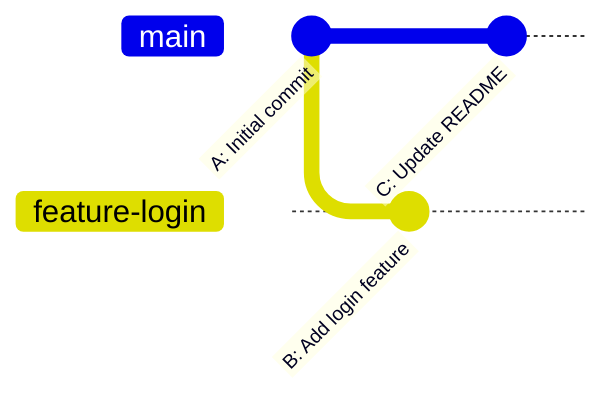
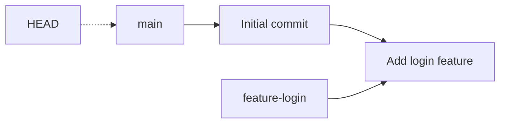
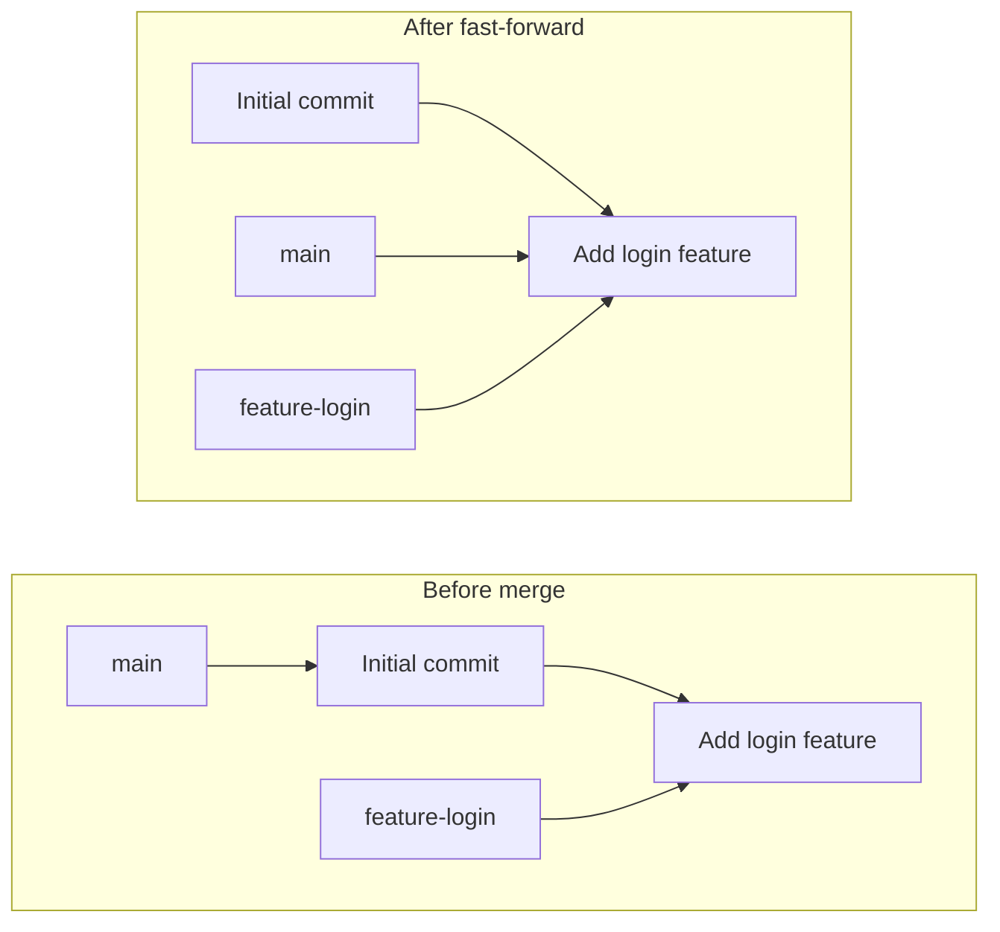
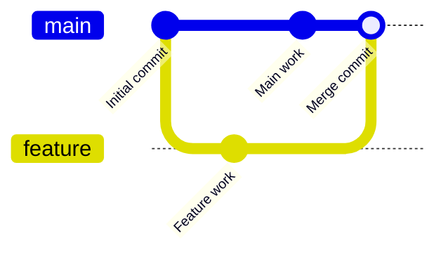
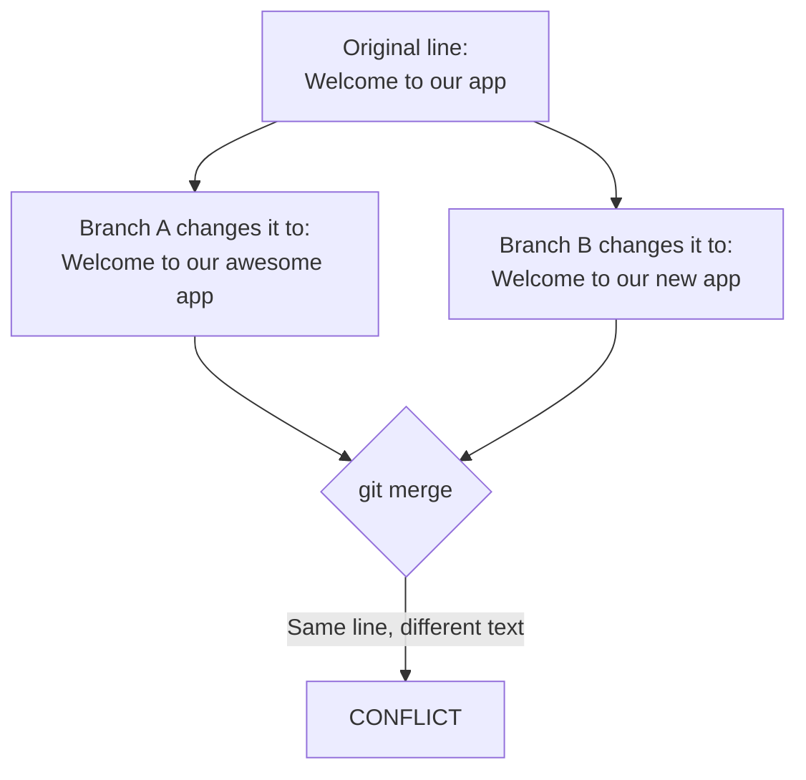
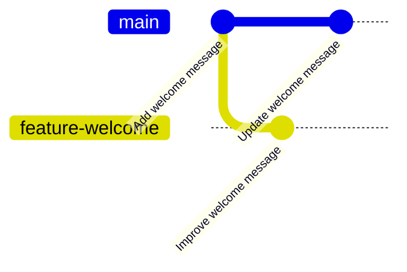
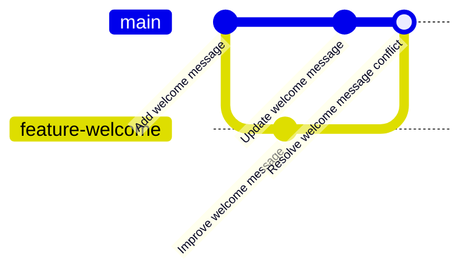
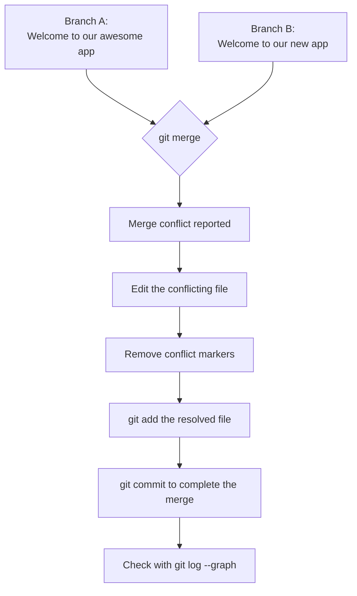
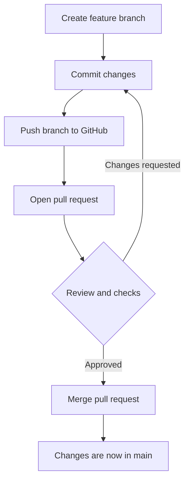
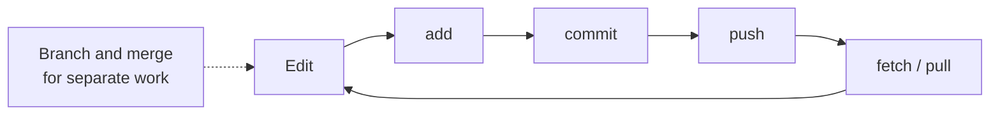

# Part 3: Branching, Merging, Merge Conflicts, and Optional Pull Requests

```text
┌──────────────────────────────────────────────┐
│ PART 3/3  git-workshop  [40 min]             │
│ $ git switch -c && git merge                 │
└──────────────────────────────────────────────┘
user@laptop:~/workshop/03-branching$ ./start_session.sh
```

**Core teaching time: 40 minutes** | Part 3 of 3 | Previous: [Part 2](02-github-and-remote-operations.md)

Tags: `[MUST_TEACH]`, `[LIVE_DEMO]`, `[STUDENT_PRACTICE]`, `[OPTIONAL]`. Callouts: **Important**, **Remember**, **Common Mistake**, **Try It Yourself**.

> **Priority:** The merge-conflict demonstration (section 5) is the main event. Pull requests (section 8) are **optional**. Never let them squeeze out the conflict exercise.

> `[i] NOTE` on outputs:** Sample outputs were produced by running these exact command sequences in a temporary repository with Git 2.43. Hashes and some wording will differ on students' machines.

---

## 1. Learning objectives

Students can:

- Explain why developers use branches.
- Create and switch branches.
- Merge a feature branch into `main`.
- Tell a fast-forward merge from a merge-commit merge.
- Explain why merge conflicts happen.
- Resolve a conflict and complete the merge.
- Describe how teams use branches and pull requests.

---

## 2. Branching concepts `[MUST_TEACH]` (about 5 min)

### What is a branch?

A **branch** is a named, movable **pointer to a commit**. It is *not* a full copy of your project. Creating a branch is almost instant and costs almost no space.

### Why use feature branches?

- Try a new feature without breaking working code.
- Several people can work at the same time.
- `main` stays stable and always works.
- Changes can be reviewed before they join `main`.

> **Analogy:** `main` is the published textbook. A feature branch is your own draft chapter. You only add it to the book after it is checked.

That is why, on team projects, people avoid committing directly to `main`.

### Two branches diverging from a common commit



Both branches share commit **A**. After that, `main` got commit **C** and `feature-login` got commit **B**. They have **diverged**.

### Commands

| Command | Purpose |
|---|---|
| `git branch` | List local branches. `*` marks the current one |
| `git switch -c <branch-name>` | **Create** a new branch and switch to it |
| `git switch <branch-name>` | Switch to an existing branch |

**Common mistake:** `git switch feature-login` when the branch does not exist yet gives `fatal: invalid reference: feature-login`. Use `-c` to create.

> `[!] IMPORTANT` Commit or discard your work before switching, and run `git status` first. Git may refuse to switch if it would overwrite uncommitted edits.

---

## 3. Hands-on branching demonstration `[LIVE_DEMO]` (about 6 min)

**Starting state:** a new repository with one commit on `main` (a `README.txt`).

```bash
mkdir branch-demo
cd branch-demo
git init -b main
echo "My project" > README.txt
git add README.txt
git commit -m "Initial commit"
```

**Step 1: confirm where you are**
```bash
git switch main
git status
```
```text
Already on 'main'
On branch main
nothing to commit, working tree clean
```
State: `main` points to **Initial commit**. `HEAD` is on `main`.

**Step 2: create and switch to a feature branch**
```bash
git switch -c feature-login
```
```text
Switched to a new branch 'feature-login'
```
State: both `main` and `feature-login` point to the same commit; `HEAD` is on `feature-login`.

**Step 3: create `login.txt`, stage and commit**
```bash
echo "Login feature added" > login.txt
git add login.txt
git commit -m "Add login feature"
```
State: `feature-login` has moved one commit ahead. `main` has not moved.

**Step 4: switch back and look**
```bash
git switch main
ls
git branch
```
```text
README.txt
  feature-login
* main
```
`login.txt` is **gone** from the folder. That is because `main` does not contain the "Add login feature" commit yet. Git swapped your working files to match `main`'s snapshot. Nothing is lost; switch back and it returns.



`[>] TRY_IT` (2 min):** `git switch feature-login`, run `ls`, then `git switch main`, run `ls`. Watch `login.txt` appear and disappear.

---

## 4. Merging branches `[MUST_TEACH]` (about 6 min)

### $ `git merge <branch-name>`

**Purpose:** Combines the history of another branch into the branch you are currently on.

> `[i] REMEMBER` The branch you are **on** is the **destination**. To bring `feature-login` into `main`, first `git switch main`.

**Syntax:**
```bash
git switch main
git merge feature-login
```

### Case 1: fast-forward merge

Used when `main` has **not** moved since the feature branch was created. Git just slides the `main` pointer forward. No new commit is created.

**Real output:**
```text
Updating b7b9a36..8cbcee5
Fast-forward
 login.txt | 1 +
 1 file changed, 1 insertion(+)
 create mode 100644 login.txt
```



```bash
git log --oneline --graph --all
```
```text
* 8cbcee5 Add login feature
* b7b9a36 Initial commit
```

### Case 2: merge commit

Used when **both** branches have new commits (they diverged). Git creates a **merge commit** with two parents.

**Real output:**
```text
Merge made by the 'ort' strategy.
 a.txt | 1 +
 1 file changed, 1 insertion(+)
 create mode 100644 a.txt
```
```text
*   00416f9 Merge branch 'f2'
|\  
| * c8e56d6 F2 work
* | ee2330e Main work
|/  
* 8cbcee5 Add login feature
```



| | Fast-forward | Merge commit |
|---|---|---|
| When | `main` has no new commits | Both branches have new commits |
| New commit created? | No | Yes |
| History shape | Straight line | Branches and joins |
| Conflicts possible? | No | Yes |

(`git merge --no-ff` forces a merge commit even when a fast-forward is possible. Mention only if asked.)

### $ `git branch -d <branch-name>`

**Purpose:** Deletes a local branch **name** once its work is merged.

```bash
git branch -d feature-login
```
```text
Deleted branch feature-login (was 8cbcee5).
```

**What it does NOT do:** It does not delete the commits already merged into `main`. It only removes the label. `-d` refuses to delete a branch with unmerged work (the safe behaviour). Use it only when the branch is no longer needed. Avoid `-D` (force) unless you are certain.

### $ `git log --oneline --graph --all`

**Purpose:** Draws the commit history of all branches as a text graph. The best way to *see* merges.

---

## 5. Merge conflicts: the main demonstration `[LIVE_DEMO]` `[STUDENT_PRACTICE]` (about 14 min)

### Why conflicts happen

Git merges by combining changes. If **both branches changed the same lines** differently, Git cannot know which version you want. It stops and asks you.



> `[!] IMPORTANT` Changes to *different* lines, or different files, usually merge automatically. Conflicts are normal, not a sign you did something wrong.

### Starting state

Run in a **new empty folder**. This sequence was tested and does produce a conflict.

```bash
mkdir conflict-demo
cd conflict-demo
git init -b main
echo "Welcome to our app" > app.txt
git add app.txt
git commit -m "Add welcome message"
git status
```
Expected: `nothing to commit, working tree clean`. **Do not continue until the tree is clean.**

### Developer A: feature branch
```bash
git switch -c feature-welcome
echo "Welcome to our awesome app" > app.txt
git add app.txt
git commit -m "Improve welcome message"
```
(`>` **overwrites** the file with one line. This is intentional: the *same line* is changed.)

### Developer B: main branch
```bash
git switch main
echo "Welcome to our new app" > app.txt
git add app.txt
git commit -m "Update welcome message"
```



### Trigger the conflict

You are on `main`:
```bash
git merge feature-welcome
```
**Real output:**
```text
Auto-merging app.txt
CONFLICT (content): Merge conflict in app.txt
Automatic merge failed; fix conflicts and then commit the result.
```

**Why:** Both branches changed line 1 of `app.txt` from `Welcome to our app` to different text.

```bash
git status
```
```text
On branch main
You have unmerged paths.
  (fix conflicts and run "git commit")
  (use "git merge --abort" to abort the merge)

Unmerged paths:
  (use "git add <file>..." to mark resolution)
	both modified:   app.txt

no changes added to commit (use "git add" and/or "git commit -a")
```
Point out: `Unmerged paths`, `both modified`, and the two hints in parentheses.

### Explain the conflict markers

Open the file (`cat app.txt`):
```text
<<<<<<< HEAD
Welcome to our new app
=======
Welcome to our awesome app
>>>>>>> feature-welcome
```

| Marker | Meaning |
|---|---|
| `<<<<<<< HEAD` | **Start** of the version from the branch you are on (`main`) |
| `Welcome to our new app` | Your current branch's version |
| `=======` | **Separator** between the two versions |
| `Welcome to our awesome app` | The incoming branch's version (`feature-welcome`) |
| `>>>>>>> feature-welcome` | **End** of the incoming version, labelled with its branch name |

> `[x] COMMON_MISTAKE` Committing with the markers still in the file. They are temporary notation by Git and must **not** remain in the final file. Search for `<<<<<<<`, `=======`, `>>>>>>>` before saving.

### Resolve the conflict

Decide the intended final content. You can keep one side, the other, or combine them. We choose to combine:
```text
Welcome to our awesome new app
```

Edit `app.txt` in any editor so that it contains **only that single line** (all five marker/old lines removed). Or, for the demo:
```bash
echo "Welcome to our awesome new app" > app.txt
```

Then mark it resolved and finish the merge:
```bash
git add app.txt
git commit -m "Resolve welcome message conflict"
```
```text
[main e823ce1] Resolve welcome message conflict
```

**Why `git add`?** During a conflict, `git add <file>` tells Git "I have resolved this file." **Why `git commit`?** It creates the merge commit and finishes the merge. (If Git has already completed the merge itself, no extra commit is needed. Follow what `git status` says.)

### Inspect the result
```bash
git log --oneline --graph --all
```
```text
*   e823ce1 Resolve welcome message conflict
|\  
| * b82e85e Improve welcome message
* | c55354b Update welcome message
|/  
* b4a576a Add welcome message
```

**What this shows:** Two lines of work diverged from `Add welcome message` and were joined by one merge commit that holds your resolution. Both original commits are preserved.



Finally, clean up (optional):
```bash
git branch -d feature-welcome
```

---

## 6. Conflict-resolution visual `[MUST_TEACH]`



### File before and after

| Stage | Content of `app.txt` |
|---|---|
| Before merge (`main`) | `Welcome to our new app` |
| Before merge (`feature-welcome`) | `Welcome to our awesome app` |
| During conflict | Both versions wrapped in `<<<<<<<` `=======` `>>>>>>>` |
| After resolution | `Welcome to our awesome new app` |

---

## 7. Recovery and safety `[MUST_TEACH]`

### Commands: `git status` and `git merge --abort`

- `git status` shows an in-progress merge and which files are unmerged. Run it **often** during a conflict.
- `git merge --abort` tries to **return to the state before you started the merge**.

```bash
git merge --abort
```

> `[!] IMPORTANT` Before aborting, look at what you changed. If you already edited files by hand and want to keep that work, copy it somewhere safe first. Abort when you want to *back out and start over*, not as a casual shortcut.

> `[!] IMPORTANT` Do not use `git reset --hard` as a routine fix for conflicts. It can permanently discard uncommitted work.

### Conflict-resolution checklist

1. Run `git status`.
2. Identify **all** conflicted files (`both modified`).
3. Open each and understand the conflicting sections.
4. Edit to the intended final content.
5. **Remove all** conflict markers.
6. `git add` each resolved file.
7. `git commit` to complete the merge, if required.
8. Check with `git status` and `git log --oneline --graph --all`.

---

## 8. OPTIONAL: contributions and pull requests

> ### OPTIONAL: COVER ONLY IF TIME REMAINS
> If you are behind schedule, skip this section entirely and tell students to read it later.

### Key ideas

| Term | Meaning |
|---|---|
| **Contribution** | Any change you propose to a project: code, docs, a bug fix |
| **Pull request (PR)** | A GitHub request saying "please review and merge my branch into yours" |
| **Fork** | Your own copy of someone else's repository, hosted under your GitHub account |
| **Collaborator** | Someone with **write access** to the repository |
| **External contributor** | Someone **without** write access; they use a fork |

**Why PRs?** They enable discussion, code review, and automated checks **before** code reaches `main`.

> `[!] IMPORTANT` **Opening a pull request does not merge anything.** It is a *request*. The merge happens only when someone with permission merges it (often after approval and passing checks).

### Scenario A: you have write access (collaborator)

No fork is needed.
```bash
git clone <repository-url>
cd <repository-folder>
git switch -c feature-about-page
# ...make changes...
git add .
git commit -m "Add about page"
git push -u origin feature-about-page
```
Then on GitHub:

1. Click **Compare & pull request** (or **Pull requests > New pull request**).
2. Choose **base** = the branch you want changes *into* (usually `main`) and **compare** = your branch (`feature-about-page`).
3. Write a clear title and description. Request reviewers.
4. Address feedback by committing and pushing more commits to the same branch; the PR updates automatically.
5. After approval and passing checks, someone merges the PR.

### Scenario B: you do not have write access (fork workflow)

1. **Fork** the original repository on GitHub.
2. **Clone your fork** to your laptop.
3. Create a **feature branch**.
4. Make and **commit** changes.
5. **Push** the branch to **your fork**.
6. Open a **pull request** from your fork's branch into the **original** repository.

(Keeping your fork up to date with the original needs an extra remote, usually named `upstream`. This is advanced; mention it only if asked.)

### Pull-request workflow



---

## 9. Final practical challenge `[STUDENT_PRACTICE]` (about 8 min)

Work in a **new, empty folder**. Do not look at the answer key until you have tried it.

Create a conflict between two branches, resolve it, and inspect the history. Use a file called `notes.txt`:

1. Create a repository with `notes.txt` containing `Study plan` and commit it on `main`.
2. Create a feature branch called `feature-plan`.
3. Change the line to `Study plan: morning` and commit it.
4. Return to `main`.
5. Change the same line to `Study plan: evening` and commit it.
6. Attempt to merge `feature-plan` into `main`.
7. Resolve the conflict so the file contains `Study plan: morning and evening`.
8. Complete the merge.
9. Inspect the final history.

<details>
<summary><strong>Answer key (hide while teaching)</strong></summary>

```bash
mkdir challenge
cd challenge
git init -b main
echo "Study plan" > notes.txt
git add notes.txt
git commit -m "Add study plan"

git switch -c feature-plan
echo "Study plan: morning" > notes.txt
git add notes.txt
git commit -m "Plan morning study"

git switch main
echo "Study plan: evening" > notes.txt
git add notes.txt
git commit -m "Plan evening study"

git merge feature-plan
```
Expected: `CONFLICT (content): Merge conflict in notes.txt` and `Automatic merge failed; fix conflicts and then commit the result.`

`notes.txt` now looks like:
```text
<<<<<<< HEAD
Study plan: evening
=======
Study plan: morning
>>>>>>> feature-plan
```

Resolve:
```bash
echo "Study plan: morning and evening" > notes.txt
git add notes.txt
git commit -m "Resolve study plan conflict"
git log --oneline --graph --all
```
Expected shape (hashes will differ): a merge commit at the top with two parents, and the two plan commits on separate lines, joined at `Add study plan`.

This follows exactly the same pattern as the main demonstration, so the behaviour was verified there. Only the file name and text differ.

</details>

---

## 10. Teaching schedule and recap

### 40-minute schedule

| Time | Activity | Type | Section |
|---|---|---|---|
| 0:00 - 0:05 | What branches are; diverging diagram | `[MUST_TEACH]` | 2 |
| 0:05 - 0:11 | Branching demo: create, commit, switch back | `[LIVE_DEMO]` | 3 |
| 0:11 - 0:17 | Merging: fast-forward vs merge commit; `branch -d` | `[MUST_TEACH]` + `[LIVE_DEMO]` | 4 |
| 0:17 - 0:31 | Conflict demo, markers, resolve (students follow) | `[LIVE_DEMO]` + `[STUDENT_PRACTICE]` | 5 to 6 |
| 0:31 - 0:33 | Safety: `merge --abort`, checklist | `[MUST_TEACH]` | 7 |
| 0:33 - 0:39 | Final challenge (fast students) / walk through (others) | `[STUDENT_PRACTICE]` | 9 |
| 0:39 - 0:40 | Wrap-up for the whole workshop | `[MUST_TEACH]` | 10 |
| (spare) | Pull requests and forks | `[OPTIONAL]` | 8 |

> **Timing tip:** If the conflict demo runs long, make section 9 homework. If you are far ahead, spend five minutes on the PR flowchart.

### Command reference

| Command | Purpose |
|---|---|
| `git branch` | List local branches |
| `git switch -c <name>` | Create and switch to a branch |
| `git switch <name>` | Switch to an existing branch |
| `git merge <name>` | Merge `<name>` into the current branch |
| `git branch -d <name>` | Delete a merged local branch |
| `git log --oneline --graph --all` | Draw the history of all branches |
| `git status` | See merge/conflict state |
| `git merge --abort` | Back out of an in-progress merge |

### Five common mistakes

1. Merging while on the wrong branch (the current branch is the destination).
2. Leaving conflict markers in the file and committing.
3. Forgetting `git add` after resolving.
4. Panicking and using `git reset --hard`.
5. Believing a pull request equals a completed merge.

### Five comprehension questions

1. Is a branch a full copy of the project?
2. You are on `main` and run `git merge feature-x`. Which branch changes?
3. When does Git create a merge commit instead of fast-forwarding?
4. What does `<<<<<<< HEAD` mark?
5. Does deleting a merged branch with `git branch -d` delete its commits from `main`?

<details>
<summary><strong>Answers</strong></summary>

1. No. It is a movable pointer to a commit.
2. `main` (the branch you are on).
3. When both branches have new commits, so their histories have diverged.
4. The start of the current branch's version in a conflicted section.
5. No. Only the branch name is removed; the commits stay in `main`.

</details>

### Workshop wrap-up

You now have the full everyday cycle:



Suggested homework: repeat the final challenge, then make a real repository on GitHub and try the collaborator pull-request flow with a friend.
